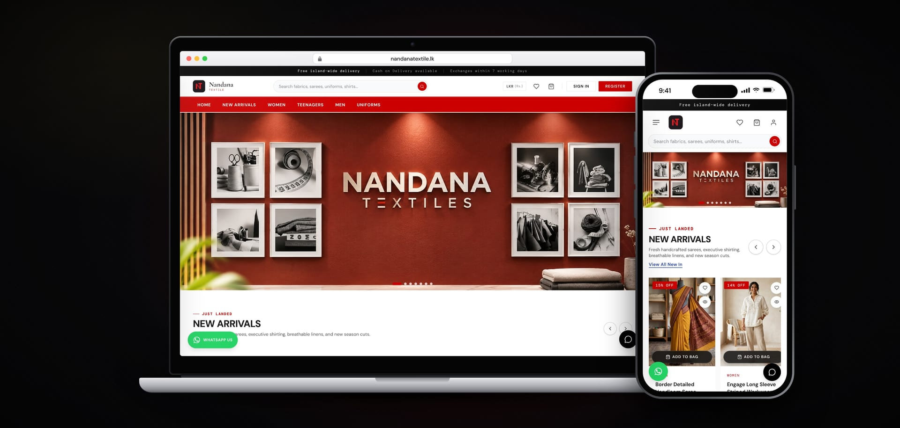
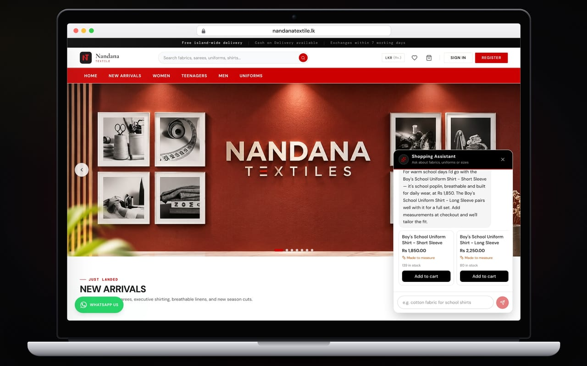
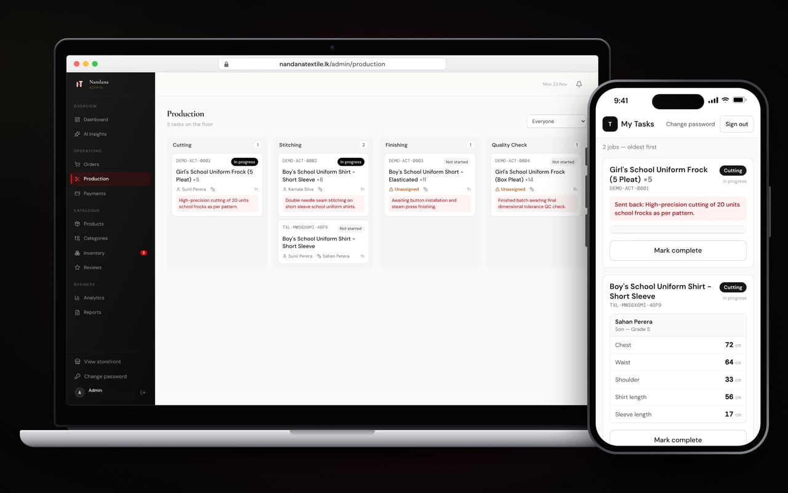
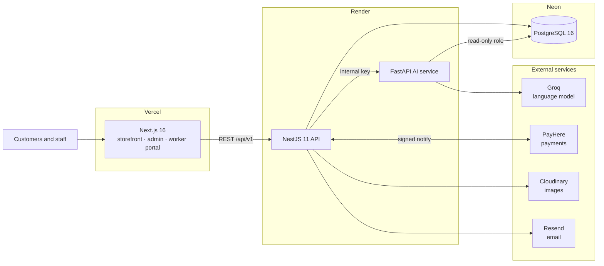

<div align="center">


# Nandana Textile

**The online shop and back office of a textile, apparel and uniform retailer in Veyangoda, Sri Lanka**

Storefront · made-to-measure ordering · payments · production floor · stock ledger · AI assistants

[](https://github.com/DininduAkalanka/textile-automation-platform/actions/workflows/ci.yml)
[](https://github.com/DininduAkalanka/textile-automation-platform/actions/workflows/playwright-nightly.yml)


[**Live site**](https://www.nandanatextile.lk) · [Admin guide](docs/ADMIN_GUIDE.md) · [Runbook](docs/RUNBOOK.md) · [Go-live checklist](docs/GO_LIVE_CHECKLIST.md) · [Security policy](SECURITY.md)

</div>

<p align="center">
  
</p>

## Overview

Nandana Textile runs its whole business on one platform. Customers shop online and order made-to-measure garments; the owner manages orders, stock, payments and the production floor; tailors work through their tasks on their phones; and two AI assistants help customers find products and help the owner understand the business, answering only from the shop's own data.

<table>
  <tr>
    <td width="50%" valign="top">
      
      <p><b>AI shopping assistant</b><br>Answers in plain language and recommends only products that exist in the catalogue, with their real prices and stock.</p>
    </td>
    <td width="50%" valign="top">
      
      <p><b>From checkout to the cutting table</b><br>Made-to-measure orders become production tasks that carry the customer's measurements; tailors move them forward from their phones.</p>
    </td>
  </tr>
</table>

## Contents

[Features](#features) · [Architecture](#architecture) · [Technology](#technology) · [Repository layout](#repository-layout) · [Getting started](#getting-started) · [Configuration](#configuration) · [Testing](#testing) · [Deployment](#deployment) · [Security](#security) · [Documentation](#documentation) · [Contributing](#contributing) · [License](#license)

## Features

**Storefront**

- Catalogue with categories, search, filters, size guides and per-size stock.
- Made-to-measure ordering: measurements per person and per item, checked for sensible ranges and sent to the tailors.
- Checkout by PayHere card payment, cash on delivery, or three monthly instalments; guest checkout with email verification.
- Accounts with verification codes, password reset, order tracking, PDF invoices, reviews with photos and a wishlist.

**Back office**

- Dashboard with revenue, paid orders, payments awaiting and low-stock alerts.
- Orders from confirmation to delivery, including cash collection and cancellation with automatic stock release.
- Products and categories with photo uploads; an inventory ledger that records every stock movement, with reorder levels.
- Payments and instalment schedules, review moderation, CSV reports, and social captions for WhatsApp, Facebook and Instagram.

**Factory floor**

- Production board: Cutting → Stitching → Finishing → Quality Check, with a quality-check failure sending work back for rework.
- Worker portal on the phone: each tailor sees only their own tasks and the customer's measurements.

**Intelligence**

- Customer assistant grounded in the live catalogue: it cannot invent products or prices.
- Business assistant for the owner, answering from the shop's own figures and flagging any number it cannot verify.
- Analytics: best sellers, trends, slow movers, reorder suggestions and a Holt-Winters demand forecast.

## Architecture



Design principles the code enforces:

- **One writer.** Only the API changes data. The AI service connects with a read-only database role that sees the catalogue and anonymised sales views, nothing else.
- **The gateway confirms payments, not the browser.** An order becomes paid only on PayHere's signed server-to-server notification, checked against the order total.
- **Stock is a ledger.** Orders reserve stock inside a locked transaction; cancellations and expired unpaid orders release it, so concurrent buyers cannot oversell.
- **The shop keeps selling if the AI is down.** The customer chat falls back to catalogue search, and analytics show an "unavailable" state instead of an error.

## Technology

| Layer | Technology |
| :--- | :--- |
| Storefront and admin | Next.js 16 (App Router), React 19, TypeScript 5, Tailwind CSS 4, TanStack Query 5, Zustand 5 |
| API | NestJS 11 on Node.js 20, Prisma 6, class-validator, Passport JWT, Helmet |
| AI service | Python 3.12, FastAPI, asyncpg, Pydantic 2, statsmodels |
| Data | PostgreSQL 16 with full-text search, an append-only stock ledger and a read-only AI role |
| Integrations | PayHere, Cloudinary, Resend, Groq; Notify.lk / Text.lk and the Meta Graph API (optional) |
| Testing | Jest, Supertest, Pytest, Cypress, Playwright, k6 |
| Delivery | Docker Compose, GitHub Actions, Vercel, Render, Neon |

## Repository layout

```text
.
├── backend/            NestJS API: modules, Prisma schema and migrations, integration tests
├── frontend/           Next.js storefront, admin and worker portal, browser tests
├── ai/                 FastAPI AI service: assistants, analytics and forecasting
├── scripts/load/       k6 load tests
├── docs/               guides, runbook, and architecture and design documents
├── .github/workflows/  CI, nightly browser tests, Render keep-alive
└── docker-compose.yml  local development stack
```

## Getting started

### Prerequisites

- Docker Desktop with Compose v2
- Node.js 20 and npm 10, to load sample data or run a service outside Docker
- Python 3.12, only to run the AI service outside Docker

### Run the stack

```bash
git clone https://github.com/DininduAkalanka/textile-automation-platform.git
cd textile-automation-platform
cp backend/.env.example backend/.env
docker compose up -d --build
```

| Service | Address |
| :--- | :--- |
| Storefront, admin and worker portal | http://localhost:3000 |
| API | http://localhost:3001/api/v1 |
| AI service | http://localhost:8000 |
| PostgreSQL | `localhost:5433` |

Every port is bound to `127.0.0.1`, so the stack is reachable from your own computer only. The API applies database migrations when it starts.

### Load sample data (optional)

```bash
cd backend
npm ci
npm run db:seed
```

This loads a sample catalogue and local test accounts for each role (`backend/prisma/seed.ts`). The seed refuses to write to any database that is not local.

<details>
<summary><b>Run a service outside Docker</b></summary>

```bash
# API: needs PostgreSQL (the Docker database works)
cd backend && npm ci && npx prisma migrate deploy && npm run start:dev

# AI service
cd ai && python -m venv .venv && . .venv/bin/activate   # Windows: .venv\Scripts\activate
pip install -r requirements.txt && uvicorn app.main:app --port 8000 --reload

# Storefront
cd frontend && npm ci && npm run dev
```

</details>

## Configuration

Each service reads environment variables. Copy the template next to it; never commit real values.

| Service | Template | Must be set in production |
| :--- | :--- | :--- |
| API | [`backend/.env.example`](backend/.env.example) | Database URLs, `JWT_SECRET`, `FRONTEND_URL`, `CORS_ALLOWED_ORIGINS`, `INTERNAL_API_KEY`, `AI_SERVICE_URL`, PayHere, Resend, Cloudinary |
| AI service | [`ai/.env.example`](ai/.env.example) | `DATABASE_URL_READONLY` (rotated password), `INTERNAL_API_KEY`, `LLM_API_KEY` |
| Storefront | [`frontend/.env.example`](frontend/.env.example) | `NEXT_PUBLIC_API_URL`, `NEXT_PUBLIC_SITE_URL` |

The full production reference is in the [Runbook, section 2](docs/RUNBOOK.md#2-configuration).

## Testing

| Suite | Command |
| :--- | :--- |
| API unit tests | `cd backend && npm test` |
| API integration tests (PostgreSQL) | `cd backend && npm run test:integration` |
| Stock ledger reconciliation | `cd backend && npm run reconcile` |
| AI service tests | `cd ai && pytest` |
| Storefront lint, types and build | `cd frontend && npm run lint && npx tsc --noEmit && npm run build` |
| End-to-end (running local stack) | `cd frontend && npm run test:e2e` (Cypress) or `npm run test:pw` (Playwright) |
| Load tests | see [`scripts/load/README.md`](scripts/load/README.md) |

Continuous integration runs on every pull request and every push to `main`: API build with unit and integration tests, stock reconciliation, storefront build and type check, Cypress, and a Playwright smoke suite. The full Playwright suite runs nightly.

## Deployment

| Component | Host | Deploys |
| :--- | :--- | :--- |
| Storefront | Vercel | automatically on merge to `main` |
| API | Render, Docker (`backend/Dockerfile`) | automatically on merge to `main`; applies migrations on start |
| AI service | Render, Docker (`ai/Dockerfile`) | automatically on merge to `main` |
| Database | Neon, PostgreSQL 16 | migrations applied by the API |

Release flow: branch → pull request → all checks green → merge. Before a release, work through the [pre-deploy checklist](docs/RUNBOOK.md#35-pre-deploy-checklist); before the first launch, the [go-live checklist](docs/GO_LIVE_CHECKLIST.md). Render's free tier puts a service to sleep after 15 minutes without traffic; see the [Runbook, section 7](docs/RUNBOOK.md#7-keeping-the-render-free-services-awake).

## Security

- Passwords hashed with bcrypt; admin passwords need at least 12 characters; accounts lock for 15 minutes after 5 failed sign-ins.
- 15-minute access tokens; refresh tokens are rotated, stored hashed and revoked on reuse, password change or deactivation.
- Every API route requires authentication unless explicitly public; admin and worker routes are role-checked; customers can read only their own orders, invoices and payments.
- PayHere notifications are verified by signature and amount, so a forged or replayed notification cannot mark an order paid.
- The AI service accepts calls only with the internal key and reads the database through a read-only role.
- The storefront sends security headers: frame blocking, `nosniff`, and referrer and permissions policies.

To report a vulnerability, follow the [security policy](SECURITY.md); please do not open a public issue.

## Documentation

| Guide | For |
| :--- | :--- |
| [Admin guide](docs/ADMIN_GUIDE.md) | The shop owner and staff: running the shop day to day |
| [Go-live checklist](docs/GO_LIVE_CHECKLIST.md) | Launching the shop for real customers |
| [Runbook](docs/RUNBOOK.md) | Hosting, configuration, releases, backups, secrets, incidents, staff accounts, go-live data reset |
| [Demo script](docs/DEMO_SCRIPT.md) | Presenting the system |
| [backend/README.md](backend/README.md) | API modules, scripts, database and tests |
| [frontend/README.md](frontend/README.md) | Storefront, admin and worker portal; SEO; tests |
| [ai/README.md](ai/README.md) | AI service endpoints, safety model and tests |
| [frontend/e2e-playwright/README.md](frontend/e2e-playwright/README.md) | Running the Playwright suites |
| [scripts/load/README.md](scripts/load/README.md) | k6 load and webhook-burst tests |

<details>
<summary><b>Architecture and design documents</b></summary>

| Document | Covers |
| :--- | :--- |
| [00 — Project vision](docs/00_PROJECT_VISION.md) | Problem, goals, users |
| [01 — Business requirements](docs/01_BUSINESS_REQUIREMENTS.md) | Business rules and acceptance criteria |
| [02 — System scope](docs/02_SYSTEM_SCOPE.md) | In and out of scope, roles |
| [03 — Software requirements](docs/03_SOFTWARE_REQUIREMENTS_SPECIFICATION.md) | Functional and non-functional requirements |
| [04 — System architecture](docs/04_SYSTEM_ARCHITECTURE.md) | Components and data flow |
| [05 — Technology stack](docs/05_TECHNOLOGY_STACK.md) | Technology choices and trade-offs |
| [06 — Database design](docs/06_DATABASE_DESIGN.md) | Schema design and indexing |
| [07 — API design](docs/07_API_DESIGN.md) | REST conventions and errors |
| [08 — AI integration design](docs/08_AI_INTEGRATION_DESIGN.md) | Assistants, retrieval, grounding |
| [09 — Security architecture](docs/09_SECURITY_ARCHITECTURE.md) | Authentication, authorisation, threats |
| [10 — UI/UX guidelines](docs/10_UI_UX_GUIDELINES.md) | Design tokens and patterns |
| [11 — Payment integration](docs/11_PAYMENT_INTEGRATION.md) | PayHere, cash on delivery, instalments |
| [12 — Deployment architecture](docs/12_DEPLOYMENT_ARCHITECTURE.md) | Hosting and environments |
| [13 — Testing strategy](docs/13_TESTING_STRATEGY.md) | Test pyramid and tooling |
| [Database architecture](docs/DATABASE_ARCHITECTURE.md) | Schema dictionary, ledger, AI views |
| [Database schema (DBML)](docs/database.dbml) | Renderable at [dbdiagram.io](https://dbdiagram.io/d) |
| [AI and ML architecture](docs/AI_AND_ML_ARCHITECTURE.md) | Assistants, forecasting, evaluation |
| [Coding standards](docs/CODING_STANDARDS.md) | Conventions for contributors |
| [Frontend UX playbook](docs/FRONTEND_UX_PLAYBOOK.md) | UX engineering practices |

</details>

## Contributing

1. Branch from `main` (`feat/…`, `fix/…`, `docs/…`) and use [Conventional Commits](https://www.conventionalcommits.org/).
2. Open a pull request and merge only when every check is green.
3. Never commit secrets or real `.env` files. When code reads a new environment variable, add it to the matching `.env.example` and to the Runbook.
4. Update the relevant documentation in the same pull request.

## License

Copyright © 2026 Nandana Textile. All rights reserved; see [LICENSE](LICENSE). The code is published for reference only and may not be used, copied or distributed without written permission.
